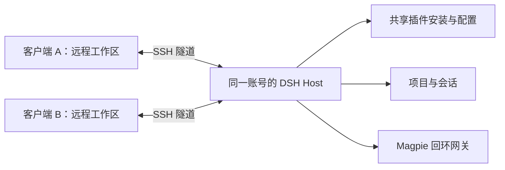

# 远端 Host、共享外观与 Magpie 实施规划

本文记录下一阶段的目标和验收条件，描述的是计划中的行为。当前实现和既有验证见 [中文使用说明](../README.zh-CN.md) 与 [架构核对](architecture-audit.md)。

## 已确定的方向

- 面向 DSH 提供综合远程控制插件，基础能力共享，功能模块各自维护服务、配置和界面。
- 本机 Desktop 与远端 DSH Host 各自管理插件安装和启用状态。
- 第一阶段的共享外观作用于远程工作区内部；多个本地客户端连接同一远端账号、同一 DSH 数据目录时共享一份配置。
- 项目新增和维护的所有模块遵循 DSH 的界面组件、主题和交互规范。
- Magpie 默认随远端 DSH Host 一起准备；兼容已有原生安装与 Docker 网关，保留现有模型管理能力。

## 现状与可复用能力

| 项目 | 当前状态 | 下一步处理 |
| --- | --- | --- |
| 本机入口 | `src/plugin-host.mjs` 注册设备接口，`src/ui/` 注册界面 | 按模块注册服务与界面，提取共享连接能力 |
| 远端启动 | `src/host.cjs` 安装固定版本 DSH、pnpm，并复用每用户 Host | 将运行时准备、依赖部署、健康检查和进程管理分开 |
| 远程界面 | 本地 webview 或浏览器加载远端官方 Web 工作区 | 延续官方客户端插件加载机制 |
| 外观配置 | 官方 `ui-theme` 提供 Host 配置与客户端主题服务 | 验证多端同步，补充受支持外观插件的配置接入 |
| Magpie | 已有目录、启停、模型同步；目前要求远端自行安装运行 | 增加安装、启动、健康检查和兼容能力检测 |
| 自有界面 | 部分控件为手写 HTML 与内联样式 | 迁移到 DSH 公共控件与语义样式变量 |

上游源码 `2e39e70496aa02986ca6a820c5d497e816b69d7e` 的包版本为 `0.2.2-rc.5`，项目远端固定版本为 `0.2.2-rc.1`。已额外检查 npm 发布的 rc.1 主题、设置及 UI primitives 包：主题读取 `ui-theme` 配置，设置客户端监听 `settings/document-updated` 与 `connection/reset`。这是源码和发布包核对，尚未替代真实多客户端运行验证。

官方主题支持 Host 持久化的明暗偏好、字体和字号；第三方主题注册及 token 覆盖是客户端扩展点，自定义主题 ID 不属于内置偏好的持久化 schema。参考 [主题说明](https://github.com/deepseek-ai/deepseek-harness/blob/2e39e70496aa02986ca6a820c5d497e816b69d7e/packages/client/ui-theme/README.zh.md) 与 [设置服务说明](https://github.com/deepseek-ai/deepseek-harness/blob/2e39e70496aa02986ca6a820c5d497e816b69d7e/packages/client/ui-settings/README.zh.md)。

## 插件与模块边界

| 层 | 负责的内容 | 配置归属 |
| --- | --- | --- |
| 本机 Desktop 插件 | 设备列表、SSH、连接状态、远端工作区入口 | 本机 DSH 数据目录 |
| 远端 DSH 插件 | 项目、会话、工具、MCP、远端功能服务 | 远端 DSH 数据目录 |
| 远端插件的浏览器部分 | 在各客户端的远程工作区中显示功能和外观 | 通过远端 Host 读写共享配置 |
| 运行时部署模块 | DSH、pnpm、Magpie 的安装及健康检查 | SSH 用户下的运行时与部署记录 |

外观插件的浏览器代码在客户端执行，安装与配置可以由远端管理，因此其他客户端连接时无需逐台安装同一个 Web 外观插件。需要 Electron 或 Desktop 专属扩展点的插件仍属于本机插件体系。

新增远端能力以官方 DSH 插件形式接入，安装、启用和卸载使用 DSH 插件管理器。本项目按需增加远端伴生包，为自有模块提供配置与服务。内部模块化先采用静态组合和明确的生命周期，客户端插件加载继续交给 DSH。

第一步拆开 `devices.mjs` 对 Magpie 的直接调度：设备与连接服务提供目标地址、连接状态及生命周期，Magpie 模块调用共享传输。保留现有 CLI 入口和旧设备数据的兼容适配，按实际依赖逐步迁移文件。

## 共享外观配置

远端 Host 是共享配置的唯一持久化来源。共享边界是同一远端账号及 DSH 数据目录，SSH 别名、本地转发端口和客户端设备 ID 都不作为配置身份。`ready.json` 的 `instance` 随 Host 重启变化，只用于验证操作目标。

1. 连接后读取 Host 配置并应用，内置主题、字体和字号沿用 `ui-theme`。
2. 在客户端修改时提交字段级变更和读取时的 revision；Host 校验、持久化并通知客户端。
3. 其他客户端收到变更后读取已提交配置；重连时重新读取完整状态。
4. 并发冲突保留未提交编辑，显示冲突并刷新远端值。断线时保留已接受的显示状态，配置写入显示为不可用，重连后再提交。
5. 外观插件的独有配置由所属插件声明 schema、命名空间与迁移规则，通过 Host settings 保存。仅写 localStorage 的第三方插件，需要适配后才能列入共享外观支持范围。

首批覆盖内置主题与排版，再接入一个实际外观插件验证自定义配置、启停和卸载。自定义主题选择保存在插件自身命名空间，由其浏览器部分调用官方主题服务恢复，遵守内置偏好的 schema。

`system` 共享的是“跟随系统”的选择，各客户端可能显示不同的明暗模式；需要统一配色时选择明确的 `light` 或 `dark`。字体名称可共享，实际显示仍取决于客户端可用字体；使用一致字体资源或明确的回退栈。窗口大小等设备局部状态保持各端独立。

## Magpie 随 Host 部署

### 首次连接与重连

默认执行“检测现有环境 → 准备 DSH 与缺失的 Magpie → 启动各自服务 → 分别检查健康状态”。DSH 与 Magpie 使用独立进程及健康状态，同一部署入口展示各阶段结果。

| 远端环境 | 部署行为 |
| --- | --- |
| 已有健康原生 Magpie | 复用其网关；核对 CLI、用户和配置归属后提供启停 |
| 已有 Docker 网关 | 复用已配置的回环端口；模型浏览与同步可用时保留，不再启动第二个原生网关 |
| 已有 CLI、网关未启动 | 检查可执行文件和现有服务，再启动兼容实例 |
| 没有 Magpie | 安装经过验证的 Linux 终端版并启动网关，纳入本插件部署记录 |
| 端口被其他服务占用 | 识别冲突，提示调整端口或配置目标，保存实际使用的端口 |
| 安装失败、离线或架构不支持 | 保留可用的 DSH，展示 Magpie 失败原因和单独重试入口 |

远端采用 Linux 终端版，首批验证 amd64 与 arm64。官方提供终端构建、`magpie serve` 与用户级 daemon，适合无桌面的 SSH 主机，见 [官方安装与服务说明](https://github.com/yetone/magpie/blob/main/docs/reference.md#install)。实现前核对所选版本的命令与发布资产。

部署实现要求：

- 新安装从官方发布渠道取得经验证的明确版本，按项目约定不执行 SHA-256 校验，在暂存位置准备后原子落盘并检查可执行文件及服务健康状态，保存版本、二进制路径、配置目录、端口和托管归属。
- 核实所选终端版的后台自更新行为，实际运行版本变化后重新检测兼容性；仅固定首次下载地址不足以宣称版本始终固定。
- 使用用户级可执行文件和服务，支持预装二进制及离线安装来源；所有依赖和重试使用同一份部署状态。
- 健康原生实例与 Docker 网关优先复用。已有账号、密钥、提供方、服务配置继续由原实例维护。
- 安装锁与启动锁覆盖多客户端同时首次连接，保证每账号单实例；失败可重试，重连复用健康服务。
- systemd 用户服务可用时优先使用，其他环境管理独立进程。DSH 重启、Magpie 重启、SSH 断开各自处理。
- DSH 就绪而 Magpie 未就绪时显示“部分就绪”；Magpie 服务正常但没有提供方时显示“待配置模型来源”，引导用户添加提供方或登录。安装完成与模型可用分别判断。
- 对本项目托管的安装提供独立升级、修复和停止；卸载保留用户数据，已有外部实例的生命周期由原部署维护。

### 兼容性边界

兼容性以实际协议和功能探测为准，版本用于记录已验证组合。当前 README 记录的测试组合是 DSH `0.2.2-rc.1`、Magpie `0.1.4539`，新部署版本需重新验证后纳入支持清单。

| 场景 | 预期结果 |
| --- | --- |
| 原生 CLI 与网关使用同一用户及配置 | 目录、符合条件的单模型启停、同步、真实对话均可用 |
| Docker 或无匹配 CLI | 目录与同步可用时保留，启停显示不可用及原因 |
| 显式端口、XDG 配置端口、默认端口 | 保持既有解析顺序；托管实例将实际端口接入同一解析流程 |
| 网关要求密钥 | 远端读取受限密钥并写入远端 DSH 凭据存储，凭据保留在远端 |
| 模型缺少可选元数据 | 保留有效模型和可用能力，使用明确的缺省值 |
| 模型移除或被通配规则停用 | 刷新后正确显示；通配规则在 Magpie 中管理 |
| DSH Host 重启 | 拒绝针对旧 instance 的写入，重连后恢复操作 |
| 模型设置存在同名提供方或并发修改 | 返回可理解的冲突，保留其他提供方和未提交选择 |
| Magpie 服务升级后部分命令变化 | 按能力禁用受影响操作，其他通过检测的能力继续可用 |

将“网关目录”“原生管理”“写入 DSH 模型设置”作为独立能力报告。DSH 设置适配集中维护命名空间、凭据引用、revision 和受管提供方 `dsh-remote-magpie`；同步操作只修改所属条目。空选择移除该受管提供方。

## 所有自有模块遵循 DSH 风格

以官方 [Web UI 样式规范](https://github.com/deepseek-ai/deepseek-harness/blob/2e39e70496aa02986ca6a820c5d497e816b69d7e/docs/web-styling.zh.md) 为基线：

- 复用官方 UI primitives 的按钮、输入框、开关、菜单、弹窗和状态组件；用标准 slot 接入导航、设置及内容区域。
- 功能样式使用 `--dsw-alias-*` 等官方语义变量，沿用排版、圆角、间距和状态颜色；组件 CSS Modules 管理布局。
- 外观扩展通过官方主题服务处理，普通业务模块消费主题。各模块共享控件适配层与反馈方式。
- 将现有设备页、Magpie 面板的手写按钮、原生确认框、固定分隔线颜色和内联呈现样式逐步迁移。
- 扩充构建对官方 primitives 及 CSS Modules 的处理，验证 React 运行时解析、样式加载和卸载，避免迁移后只有组件代码而没有样式。
- 为颜色字面量、主题选择器和全局样式泄漏增加有针对性的静态检查；界面验收覆盖深浅主题、键盘、窄窗口及空态、加载、错误和禁用状态。

项目维护的模块都按此验收。外部插件通过兼容性及界面检查后列入推荐支持清单，任意第三方插件的外观不能由本项目自动保证。

## 实施顺序与完成标准

| 阶段 | 交付内容 | 完成标准 |
| --- | --- | --- |
| 1. 兼容基线 | 固定当前 DSH/Magpie 组合；验证官方主题同步、插件加载和 UI 构建；选择自动部署资产 | 两客户端共享设置验证通过；当前 Magpie 原生功能回归通过；候选终端版能在目标架构运行 |
| 2. Host 与 Magpie 部署 | 拆分安装、复用、进程、健康检查；集成 Magpie 自动安装与启动 | 全新环境、已有安装、Docker、下载失败、并发连接和再次连接都有明确结果；旧数据可继续读取 |
| 3. 模块与界面整理 | 拆开设备与 Magpie 调度，建立共享传输及 UI 适配层 | 设备连接和模型管理功能保持可用；自有面板符合 DSH 风格 |
| 4. 共享外观扩展 | 接入官方 settings；适配一个外观插件，完善冲突和重连行为 | 修改、双端同步、重启恢复、插件卸载和失败恢复均通过 |
| 5. 发布验证 | 打包加载、兼容矩阵、迁移说明和图形界面验证 | 明确支持的版本/架构/部署方式，实际执行结果与未验证项分别记录 |

先完成当前固定版本的验证，再独立评估 DSH 升级。运行时升级保留 `data/`、凭据和外观配置，并验证回退。

验收至少覆盖：

1. 空白远端通过一次连接流程安装并启动 DSH 与 Magpie；重复连接及两个客户端同时连接均复用同一套服务。
2. 已有原生或 Docker Magpie 被正确识别，原配置与提供方可继续使用；安装失败可单独修复。
3. 客户端 A 修改主题/字体/字号，B 无需重新连接即可更新；B 断线后重连、Host 重启后配置仍保留。
4. 两端同时修改时识别过期 revision；切换服务器或远端账号时配置彼此独立。
5. 外观插件安装、启停、配置更新和卸载在两个客户端中正确体现，主题资源可释放。
6. Magpie 目录、单模型停用/恢复、模型同步与经网关的真实 DSH 对话通过；密钥、缺失 CLI、Docker、旧 instance 及并发设置冲突有对应验证。
7. 每个自有界面在深浅主题与窄窗口下可操作，反馈、控件和字体风格与 DSH 保持一致。

沿用现有 `npm test`、SSH 端到端测试和安装包加载测试，针对上述新增行为补充必要用例。图形界面检查与服务端测试分别记录；仓库当前测试记录不视为本规划已经实施。
